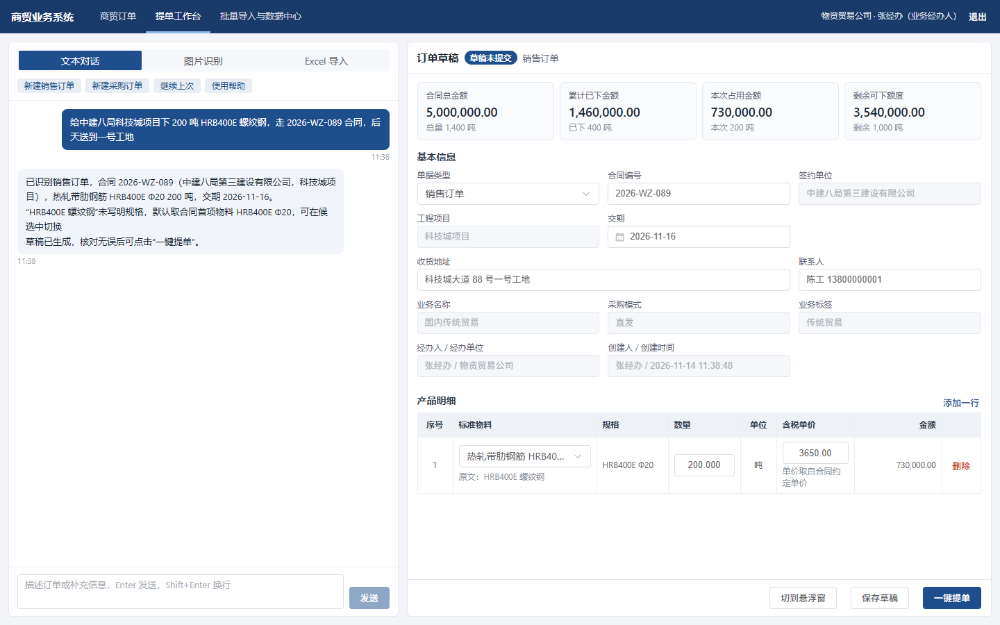
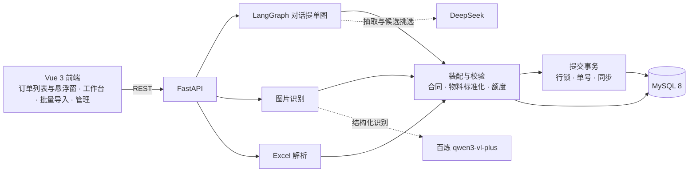

# 智能商贸提单助手

大宗商贸业务的智能提单助手（项目实战 2.10）。经办人用自然语言对话、单据图片或 Excel 批量生成订单草稿；系统关联合同主数据、核验履约额度，提交后写入模拟商贸系统。审批人在订单列表中完成审批，管理员维护主数据和参数。



- [项目介绍](docs/项目介绍.md)：背景、角色、功能全景、一次提单的完整过程、关键取舍与结果
- [架构设计](docs/架构设计.md)：分层、数据模型、对话提单图、物料标准化、提交事务与并发控制、状态流转
- [评估与压测](docs/评估与压测.md)：自动化测试、识别质量评估、提交与读取压测
- [验收核对](docs/验收核对.md)：逐条核对 45 条需求与 8 条成功标准，附 41 张截图

## 功能

- **三种录入方式**：多轮自然语言对话、单据图片识别（发货签收单、磅单、合同）、Excel 批量导入，都支持销售和采购订单。
- **物料标准化**：俗称、简称、识别误差映射到物料字典编码；规则分不出时由模型在候选中挑选，编码只可能来自字典。
- **履约核验**：合同自动带出签约单位、项目、地址和联系人；额度四项统计；金额超额需备注并转待特批，数量超出、交期越界、公允价偏离、配额阈值分级提示。
- **一键提单**：服务端重新校验，合同行锁内核验额度并生成单号，同一草稿重复提交只生成一笔，同步写入模拟商贸系统。
- **双模态交互**：订单列表右下角悬浮窗与全屏工作台双向切换，对话和草稿不丢；提单后列表自动刷新。
- **审批**：审核通过、退回修改、驳回；退回订单修改后沿用原单号重提。
- **主数据与配置**：合同台账、物料字典与别名、额度与模型参数、审计日志；三类角色，按部门隔离数据。

## 架构



大模型只负责从文字和图片里抽取字段、在规则给出的候选中挑选物料；合同、编码、额度、超额、单号和状态都由数据库和规则决定。详见 [架构设计](docs/架构设计.md)。

## 技术栈

| 部分 | 选型 |
| --- | --- |
| 后端 | Python 3.12+、FastAPI、SQLAlchemy 2（async，aiomysql）、LangGraph |
| 数据库 | 本机 MySQL 8.0（Windows 服务 `MySQL80`） |
| 文本模型 | DeepSeek（OpenAI 兼容接口） |
| 视觉模型 | 阿里云百炼 `qwen3-vl-plus`（兼容模式） |
| 前端 | Vue 3、Vite、TypeScript、Element Plus、Pinia |

## 从零启动（Windows）

以下命令在 PowerShell 7 中执行，路径以项目根目录为准。

### 1. 准备环境

需要先安装：

- [uv](https://docs.astral.sh/uv/)：管理 Python 与后端依赖，首次同步时会自动下载 Python 3.12 以上版本；
- Node.js 20.19 或 22.12 以上（Vite 8 的要求）；
- MySQL 8.0，安装为 Windows 服务 `MySQL80`。

### 2. 启动 MySQL

`MySQL80` 服务默认不随系统启动，使用前在管理员 PowerShell 中启动：

```powershell
Start-Service MySQL80
```

确认状态为 `Running`：

```powershell
Get-Service MySQL80
```

数据库不需要手动创建，第 4 步的初始化脚本会自动创建 `trade_order` 库（utf8mb4）。

### 3. 配置 `.env`

```powershell
Copy-Item .env.example .env
```

然后编辑项目根目录的 `.env`，至少填写：

| 变量 | 说明 |
| --- | --- |
| `DATABASE_URL` | 把 `<password>` 换成 MySQL root 密码；库名可保持 `trade_order` |
| `JWT_SECRET` | 32 字节以上的随机字符串 |
| `DEEPSEEK_API_KEY` | DeepSeek 开放平台的 API Key，对话提单需要 |
| `DASHSCOPE_API_KEY` | 阿里云百炼的 API Key，图片识别需要 |

`TEST_DATABASE_URL` 只在运行后端测试时使用，测试会清空该库，不要指向业务库。生成随机密钥可用：

```powershell
-join ((1..48) | ForEach-Object { [char](Get-Random -Minimum 33 -Maximum 127) })
```

`.env` 已在 `.gitignore` 中，真实密钥只放在这里。

### 4. 安装后端依赖并初始化数据

```powershell
cd backend
uv sync
uv run python -m scripts.seed
```

初始化脚本会建表并灌入示例数据：两个部门、五个账号、5 份合同、27 种物料及 120 个别名、1 笔历史订单。脚本可重复执行，已有的数据不会重复插入。

示例单据图片和批量导入 Excel 已放在 [samples](samples) 目录；需要重新生成时执行：

```powershell
uv run python -m scripts.make_samples
```

### 5. 启动后端

仍在 `backend` 目录：

```powershell
uv run uvicorn app.main:app --port 8000
```

看到 `Uvicorn running on http://127.0.0.1:8000` 即启动成功，可访问 <http://127.0.0.1:8000/api/health> 检查。

### 6. 启动前端

另开一个 PowerShell 窗口，在项目根目录执行：

```powershell
cd frontend
npm install
npm run dev
```

浏览器打开 <http://localhost:5173>。前端开发服务器把 `/api` 转发到 `127.0.0.1:8000`。

## 示例账号

密码均为 `Demo@2026`。

| 账号 | 姓名 | 角色 | 部门 | 登录后进入 |
| --- | --- | --- | --- | --- |
| `jbr01` | 张经办 | 业务经办人 | 物资贸易公司 | 商贸订单列表 |
| `spr01` | 李审批 | 业务审批人 | 物资贸易公司 | 商贸订单列表（只看待审订单） |
| `admin` | 王管理 | 系统管理员 | 物资贸易公司 | 主数据与系统配置 |
| `jbr02` | 赵经办 | 业务经办人 | 建材贸易公司 | 商贸订单列表 |
| `spr02` | 钱审批 | 业务审批人 | 建材贸易公司 | 商贸订单列表 |

## 演示场景

### 场景一：自然语言提单

1. 用 `jbr01` 登录，点击顶部“提单工作台”。
2. 在文本对话框输入：

   ```text
   给中建八局科技城项目下 200 吨 HRB400E 螺纹钢，走 2026-WZ-089 合同，后天送到一号工地
   ```

3. 右侧生成销售订单草稿：签约单位、收货地址、联系人由合同带出，物料映射为 `STL-RB-400E-20`，单价取合同约定单价，交期为后天，额度卡片显示合同剩余可下金额。
4. 点击“一键提单”，得到 `XSDD-WZGS-yyyyMMdd-001` 格式的订单号；回到“商贸订单”能看到这笔订单。

### 场景二：单据图片识别与超额预警

1. 在工作台切到“图片识别”，上传 [samples/发货签收单_42.5水泥.jpg](samples/发货签收单_42.5水泥.jpg)。
2. 识别卡片显示 42.5 水泥 500 吨、金额 22 万元，点击“应用为草稿”。
3. 采购合同 `2026-CG-031` 剩余额度不足，草稿显示超额横幅；在备注中说明原因后提交，订单进入“待特批”。
4. 用 `spr01` 登录，在订单详情抽屉中审核通过、退回修改或驳回。

### 批量导入

在“批量导入与数据中心”上传 [samples/批量订单示例.xlsx](samples/批量订单示例.xlsx)，合同号错误、单价缺失、超额三类异常行会标红，修正后可批量提交。

## 重置演示数据

演示过程会累计订单并占用合同额度，同一合同反复演示后可能超额。需要回到初始状态时，删除业务库后重新初始化（会清空 `trade_order` 库中的全部数据）：

```powershell
mysql -u root -p -e "DROP DATABASE trade_order"
cd backend
uv run python -m scripts.seed
```

`mysql` 命令位于 MySQL 安装目录的 `bin` 下（默认 `C:\Program Files\MySQL\MySQL Server 8.0\bin`），未加入 PATH 时用完整路径调用。

## 测试、评估与压测

以下命令都在 `backend` 目录执行。

后端测试需要 `.env` 中配置 `TEST_DATABASE_URL`，每个测试会重建该库并灌入示例数据；调用大模型的环节用固定输出代替，不消耗模型额度：

```powershell
uv run pytest -q
```

识别质量评估和提单压测各自新建独立数据库并启动临时后端实例，结束后删除，不影响业务库；两者都会调用真实模型，消耗少量额度：

```powershell
uv run python -m scripts.eval_quality --out eval.json
```

```powershell
uv run python -m scripts.load_test --levels 1,4,8,16 --orders 40 --batch-rows 500 --chat 12 --out lt.json
```

2026-11-14 本机（Core Ultra 5 225H、MySQL 8.0.43、单进程后端）的结果：

| 项 | 结果 |
| --- | --- |
| 自动化测试 | 49 个用例全部通过 |
| 物料标准化 | 120 个别名、27 个编码全部正确；“名称 + 规格”经模型挑选后 27/27；无字典外编码 |
| 对话抽取（20 条语句） | 合同号、物料与数量、交期、单价全部正确；单据类型 17/20 |
| 图片识别（原图 + 4 种画质变体） | 5/5 全部字段正确，单次约 3.5 秒 |
| 对话单轮响应 | 44 次请求最长 1.79 秒（要求 15 秒内） |
| 提交 | 约每秒 90 笔；100 个重复提交请求只生成 20 笔；40 笔争抢 6 笔额度，判定全部正确 |
| 读取接口 | 约每秒 230 次请求，并发 1 时 p95 9 ms |
| 批量导入 500 行 | 校验 6.6 秒，提交 16 秒，全部成功 |

方法、完整数据和分析见 [评估与压测](docs/评估与压测.md)。

## 目录

```text
backend/    FastAPI 后端：app/ 源码，scripts/ 初始化、样例生成、评估与压测，tests/ 测试，prompts/ 模型提示词
frontend/   Vue 3 前端
samples/    示例单据图片与批量导入 Excel
docs/       需求、规范、方案、任务清单与测试截图
```

## 文档

| 文档 | 内容 |
| --- | --- |
| [项目介绍](docs/项目介绍.md) | 背景、角色、功能全景、提单过程、技术选型、关键取舍、结果与局限 |
| [架构设计](docs/架构设计.md) | 分层、数据模型、三条录入链路、提交事务与并发控制、状态流转、前端、权限审计 |
| [评估与压测](docs/评估与压测.md) | 自动化测试、识别质量评估、提单压测的方法、数据与分析 |
| [验收核对](docs/验收核对.md) | 逐条核对需求、成功标准与约束 |
| [需求说明](docs/需求说明.md) | 原始需求（项目实战 2.10） |
| [SPEC](docs/SPEC.md) | 范围、需求、成功标准、决策记录 D-001～D-021 |
| [DESIGN](docs/DESIGN.md) | 实现方案与约定 |
| [TASKS](docs/TASKS.md) | 任务清单 |
