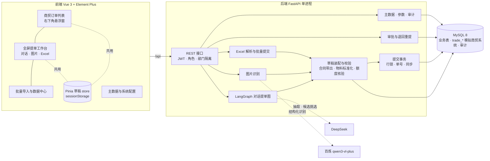
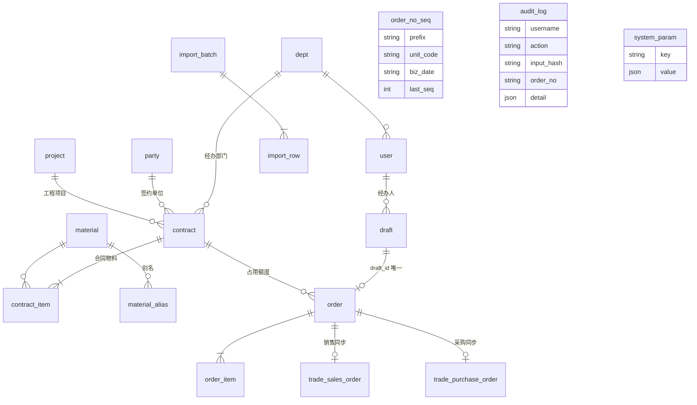
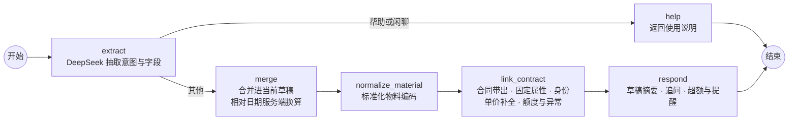
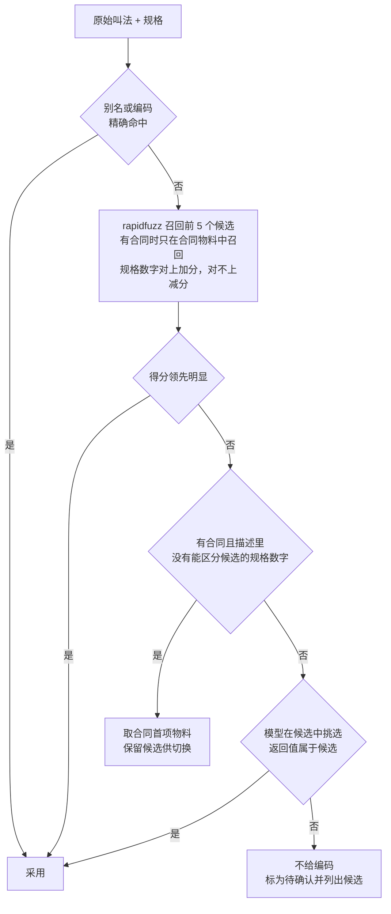
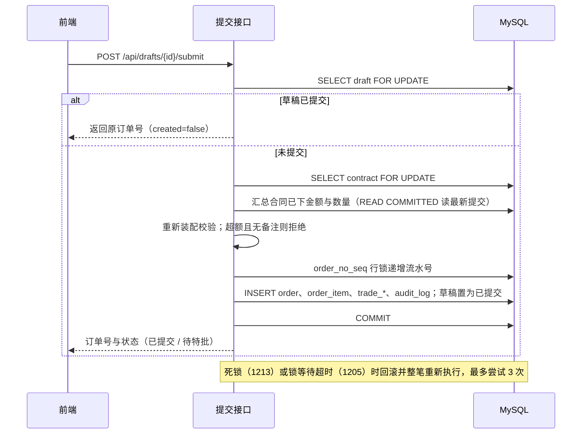
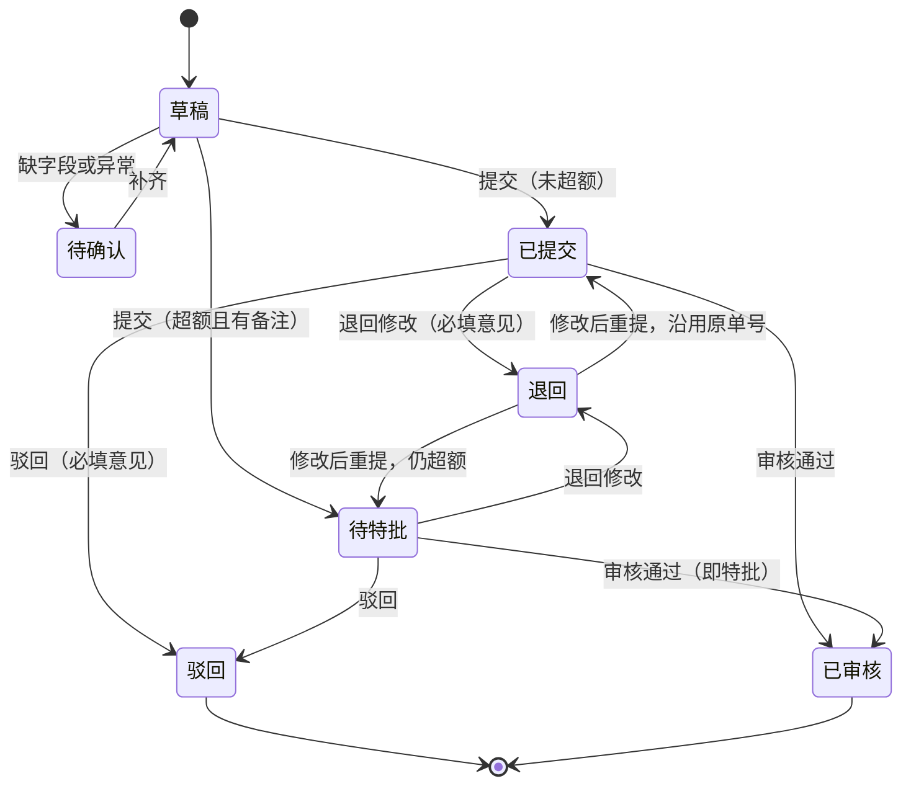

# 架构设计

本文说明系统的分层、数据模型、三条录入链路的处理流程、提交事务与并发控制、状态流转和权限审计。项目整体情况见 [项目介绍.md](项目介绍.md)，实现细节与约定见 [DESIGN.md](DESIGN.md)，性能与识别质量见 [评估与压测.md](评估与压测.md)。

## 1. 总体架构

| 层 | 主要模块 | 位置 |
| --- | --- | --- |
| 接口 | 登录、对话、图片识别、批量导入、草稿、订单、审批、主数据、参数、审计 | `backend/app/api/` |
| 编排 | LangGraph 对话提单图，每轮执行一次，不用 checkpointer | `backend/app/graph/` |
| 业务服务 | 物料标准化、草稿装配与校验、额度计算、提交与审批事务、单号、商贸同步、审计、日期换算 | `backend/app/services/` |
| 模型客户端 | 文本模型 JSON 输出、视觉模型、参数从 `system_param` 读取 | `backend/app/llm/` |
| 数据 | SQLAlchemy 2 异步模型，READ COMMITTED 隔离级别 | `backend/app/models/`、`backend/app/core/db.py` |
| 前端 | 视图、输入面板、预览区、悬浮窗、详情抽屉、管理页签 | `frontend/src/` |

设计上的主线是**大模型只负责理解，业务结论由规则得出**：模型从自然语言和图片里抽出字段，或在规则给出的候选中挑一个物料；合同带出、物料编码、额度、超额、单号、状态都由数据库和规则决定。物料编码因此只可能来自物料字典（C-002），模型失败时草稿保持原样，经办人仍可在预览区手工编辑。

## 2. 数据模型

- **额度不存累计值**。合同的已下金额和数量每次从 `order` 实时汇总，驳回的订单不计入（D-009）。这样审批、退回、重提时不需要回写合同，也不会出现累计值与订单不一致的情况。
- **`order` 与 `trade_*` 分开**。`order` 是本系统的正式订单，`trade_sales_order` / `trade_purchase_order` 模拟底层商贸系统，存提交时的快照，在同一事务内同步写入。
- **草稿是会话状态的唯一来源**。对话、预览区编辑、图片应用、退回修改都读写同一行 `draft`；前端只在 sessionStorage 里保存对话记录和当前草稿视图。

## 3. 三条录入链路

三条链路共用同一套装配与校验（`draft_validator.assemble`），区别只在字段从哪里来。

| 链路 | 字段来源 | 物料标准化 | 缺单价时 | 产出 |
| --- | --- | --- | --- | --- |
| 对话 | DeepSeek 按 JSON 抽取，与当前草稿合并 | 别名 → 模糊匹配 → 合同首项 → 模型在候选中挑选 | 金额 ÷ 数量，再取合同单价 | 草稿 + 回复（含追问） |
| 图片 | 百炼视觉模型按 JSON 识别 | 同上 | 同上 | 识别卡片，点击后新建草稿 |
| Excel | 按模板逐行解析 | 别名 → 模糊匹配，不调用模型 | 不补，标为异常（D-019） | 校验结果表，批量提交 |

### 3.1 对话提单图

- 快捷操作（新建销售、新建采购、继续上次、帮助）不进图，由接口直接处理。
- `extract` 把当前草稿摘要和本轮消息一起交给模型，模型只输出 JSON：意图、单据类型、合同号、项目、地址、联系人、交期原文、物资列表。交期原文由 `date_phrase` 在服务端按业务时钟（UTC+8）换算，模型不算日期。
- `merge` 只覆盖本轮给出的字段；物资的原始叫法没变时保留已映射的编码，所以“数量改成 300 吨”不会重新映射物料。
- 单据类型：用户本轮没有表明销售或采购、又关联了新的合同时，按合同类型确定，与图片识别一致；明确表明的类型与合同不符时保留，由校验报类型不符（D-022）。
- `link_contract` 调用装配函数，完成合同带出、固定业务属性、经办人与经办单位、单价补全和额度核验，产出字段级的问题列表：`error` 阻止提交并在预览区高亮，`over` 显示超额横幅，`warning` 黄色提醒。

### 3.2 物料标准化

物料编码只可能来自别名表、物料字典或候选列表，模型返回候选之外的编码会被丢弃。别名在每次请求时从数据库读取，管理员新增别名后下一轮对话立即生效。

### 3.3 额度核验

| 情况 | 级别 | 效果 |
| --- | --- | --- |
| 本次金额 > 合同剩余可下金额 | 超额 | 超额横幅；提交必须填写备注，订单进入待特批 |
| 本次数量 > 合同剩余可下数量 | 异常 | 字段高亮，不触发超额（D-007） |
| 单价偏离物料公允价超过允许比例 | 提醒 | 黄色提示，显示公允价 |
| 提交后剩余金额占比低于配额阈值 | 提醒 | 黄色额度预警 |
| 交期早于今天或晚于合同到期日、合同与单据类型不符、物料未映射、必填缺失 | 异常 | 字段高亮，对话中追问 |

偏离比例和配额阈值由管理员在参数页配置，只有金额超额一条会改变订单状态（D-014）。退回订单修改时，额度计算排除该订单自身原来的占用。

## 4. 提交事务与并发控制

| 问题 | 机制 |
| --- | --- |
| 同一草稿重复点击、重复请求 | 草稿行锁让请求串行，后到的请求直接返回已生成的订单；`order.draft_id` 唯一索引兜底 |
| 并发提交共用同一份剩余额度 | 合同行锁让同一合同的提交串行，锁内重新汇总额度 |
| 汇总读到旧数据 | 连接使用 READ COMMITTED；MySQL 默认的 REPEATABLE READ 会让加锁后的汇总仍读事务开始时的快照 |
| 单号重复或跳号 | `order_no_seq` 按（前缀，单位代码，日期）一行，在同一事务内加锁递增 |
| 批量提交与校验结果不一致 | 不同合同的行并发提交，同一合同的行按行号串行 |

压测中，同一草稿 5 次并发提交只生成 1 笔订单；40 笔并发争抢只够 6 笔的额度时，恰好 6 笔未超额，逐笔复算全部一致（[评估与压测](评估与压测.md#42-正确性)）。

## 5. 订单状态

驳回是终态并释放额度；退回期间额度保留，重提时重新核验（D-009、D-010）。审批对订单行加锁，只处理已提交和待特批状态，结果同步到 `trade_*` 表。

## 6. 前端

| 组件 | 职责 |
| --- | --- |
| `TradeOrders.vue` | 模拟商贸系统订单列表：销售 / 采购页签、筛选、详情抽屉、审批按钮；经办人右下角挂悬浮窗 |
| `Workbench.vue` | 左侧三个输入面板（对话、图片、Excel），右侧草稿预览区 |
| `FloatingWidget.vue`、`DraftMiniCard.vue` | 悬浮窗对话与精简草稿卡片，卡片上一键提单 |
| `DraftPreview.vue`、`QuotaCards.vue`、`SubmitBar.vue` | 状态胶囊、额度卡片、超额横幅、基本信息、产品明细、提单操作栏 |
| `Batch.vue` | 上传、校验结果表、行内修改、批量提交、导入记录 |
| `Admin.vue` 与 `components/admin/` | 合同台账、物料与别名、参数配置、审计日志 |
| `stores/draft.ts` | 会话 ID、对话记录、草稿视图，写入 sessionStorage；悬浮窗与工作台共用 |
| `bus/orderBus.ts` | 提单成功后用 `window.postMessage` 广播 `order:created`，订单列表收到后刷新并高亮新订单 |

悬浮窗和工作台读写同一个 Pinia store，所以来回切换时对话和草稿不需要同步；刷新页面时从 sessionStorage 恢复。路由守卫按角色过滤导航，直接访问无权页面时跳到角色默认页。

## 7. 权限与审计

| 角色 | 可访问 | 数据范围 |
| --- | --- | --- |
| 业务经办人 | 订单列表、工作台、批量导入 | 本部门订单和合同；草稿只能读写自己的 |
| 业务审批人 | 订单列表（只列已提交、待特批）、审批 | 本部门 |
| 系统管理员 | 主数据与系统配置 | 全部部门的合同、物料、参数和审计日志；不访问订单 |

所有业务接口先校验 JWT 和角色，再按 `dept_id` 过滤；跨部门访问一律返回 404，不暴露资源是否存在。审计日志只追加，随业务事务一起提交，覆盖登录、对话、草稿保存、图片识别（图片 SHA-256）、Excel 导入、提交、重提、审批、主数据和参数修改；主数据和参数的记录包含修改前后的值。
